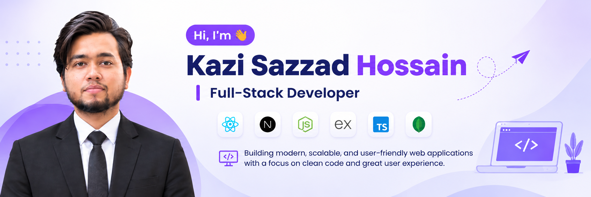

<!-- ================= PROFILE HEADER ================= -->

  

<h1 align="center">Hi 👋, I'm Kazi Sazzad Hossain</h1>

<h3 align="center">Full-Stack Web Developer</h3>

  Building modern, responsive, and scalable web applications.

  

---

## 👨‍💻 About Me

- 🔭 I'm currently working on [StudioSpace](https://studio-space-roan.vercel.app)
- 🌱 I'm currently learning **Express.js**
- 👨‍💻 All of my projects are available on my [Portfolio](https://portfolio-dun-eta-wewxeug7cz.vercel.app)
- 💬 Ask me about **React.js, Next.js, Node.js, and Express.js**
- 📫 Reach me at **sh7201@gmail.com**
- 📄 [View My Resume](https://drive.google.com/file/d/1hxVhxV5ipyL_O_jNx3K1vLyPdkW3Jasf/view?usp=sharing)

---

## 🚀 Featured Project

### StudioSpace

A creative studio discovery and booking platform.

- Studio discovery and category-based browsing.
- User authentication and account management.
- Studio listing management.
- Booking and reservation management.

  
  

---

## 🛠️ Languages and Tools

### Programming Languages

  

### Frontend Development

  

### Backend Development

  

### Database & Tools

  

### Data Science & Machine Learning

  

---

## 🏆 Achievements

- 🥇 **Mathematics Olympiad:** Secured 1st Place at the Regional Division level.

---

## 📊 GitHub Statistics

  

  

  

---

## 🤝 Connect With Me

  

  

  📧 Email: <a href="mailto:shu7201@gmail.com">sh7201@gmail.com</a>

---

  <b>Building • Learning • Improving</b>

  <i>"Turning ideas into meaningful digital experiences."</i>

